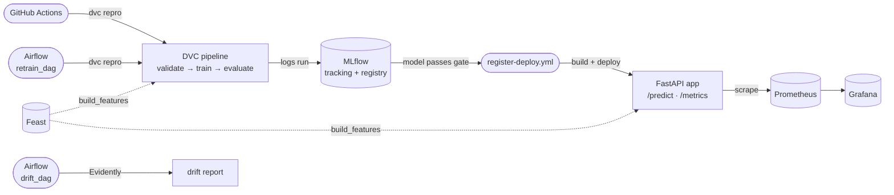

# MLOps CI/CD — Iris, on GitHub Actions


A hands-on, production-shaped MLOps pipeline built phase by phase: data validation, reproducible
training, a hard baseline gate, a full ML test pyramid, GitHub Actions CI/CD (validated locally with
`act` before touching real cloud), a containerized FastAPI serving layer with Prometheus metrics,
real GCP deployment via Terraform, drift monitoring, Airflow orchestration, and a Feast feature store.

Built on the Iris dataset to prove the pipeline shape end-to-end.

## Why this exists

Most "MLOps demo" repos either skip the boring-but-critical parts (schema validation, regression gates,
ML-specific test tiers) or bolt on cloud infra without ever proving the pipeline locally first. This
project inverts that: every stage is built and gated locally (Docker Compose + `act`) before it's ever
pointed at a real cloud, so failures show up on a laptop in seconds, not in a GitHub Actions run five
minutes later.

## Tech stack

**Pipeline & ML**
<br/>


**Tracking, versioning & feature store**
<br/>


**Serving & monitoring**
<br/>


**Orchestration & CI/CD**
<br/>


**Cloud & infra**
<br/>


## Architecture



- **`src/mlcicd/`** — the library: data loading + pandera schema validation, shared train/serve feature
  building, training, baseline-gated evaluation, model registration.
- **`app/`** — FastAPI serving layer. Loads the model from the **MLflow registry**, never from a local
  file, so serving always reflects whatever passed the evaluation gate.
- **`dvc.yaml` / `params.yaml`** — pipeline stages and every threshold/tolerance, kept out of Python code.
- **`orchestration/dags/`** — Airflow DAGs (`retrain_dag`, `drift_dag`) calling the same CLI entrypoints
  as GitHub Actions; local only.
- **`feature_repo/`** — Feast feature store (local profile: file/Dask offline + SQLite online).
- **`infra/docker-compose.yml`** — local stack: fake-gcs (DVC remote emulator), MLflow, model registry,
  the serving API, Prometheus, Grafana, Airflow.
- **`.github/workflows/`** — CI (lint + fast test tiers on PR), training (full `dvc repro` + baseline
  gate), deploy, drift, and Feast apply — all validated locally with `act` before running for real.
- **`profiles/{local,github,prod,onprem}.env`** — environment-specific endpoints; code reads a profile,
  never branches on hostname.

## Engineering principles this project follows

- **Fail-closed gates, not warnings.** The evaluate stage exits non-zero on any metric regression
  against `baselines/metrics_baseline.json` — CI fails, nothing gets registered.
- **One preprocessing path.** `features/build.py` is shared between training and serving — no
  train/serve skew from duplicated logic.
- **Local-first cloud.** Every workflow is proven against a local Docker Compose stack and `act` before
  it ever touches real GCP.
- **No long-lived cloud credentials.** GitHub Actions authenticates to GCP via Workload Identity
  Federation — no downloadable service-account key ever sits in a repo secret.
- **A real ML test pyramid**, not just unit tests: data validation, pre/post-train model checks
  (shape, overfitting, invariance, calibration), regression tests (baseline + golden-set stability +
  run-to-run reproducibility), and serving-layer contract + latency tests.

## Pipeline stages (`dvc.yaml`)

| Stage | What it does |
|---|---|
| `validate` | Pandera schema check on raw data — range, type, null, duplicate-row checks |
| `train` | Fits a scikit-learn pipeline, logs params/metrics/model to MLflow, writes `metrics.json` |
| `evaluate` | Compares `metrics.json` against `baselines/metrics_baseline.json` within tolerance — **exits 1 on regression** |

## Running locally

```bash
# 1. Install deps
pip install -r requirements.txt -r requirements-dev.txt
pip install -e .

# 2. Local infra: fake-gcs, MLflow, registry
docker compose -f infra/docker-compose.yml up -d fake-gcs mlflow registry

# 3. Run the DVC pipeline end-to-end
dvc pull
dvc repro

# 4. Bring up serving + monitoring
docker compose -f infra/docker-compose.yml up -d --build app prometheus grafana
curl -X POST http://localhost:8000/predict \
  -H "Content-Type: application/json" \
  -d '{"sepal_length":5.0,"sepal_width":3.6,"petal_length":1.4,"petal_width":0.2}'
```

Optional pieces of the local stack:

```bash
# Airflow (orchestration) — webserver on http://localhost:8080
docker compose -f infra/docker-compose.yml up -d airflow-db airflow-init airflow-webserver airflow-scheduler

# Feast (feature store)
make feast-apply
make feast-materialize
```

See [`scripts/README.md`](scripts/README.md) for the scripted version (`local-up.ps1` / `local-down.ps1`),
which also seeds the model registry and waits for health checks.

## Running on GCP

Provisions a real GCS bucket, Artifact Registry, Cloud Run service, and Workload Identity Federation
via Terraform (`infra/gcp`), then deploys through GitHub Actions.

```powershell
gcloud auth login
gcloud auth application-default login
gh auth login

.\scripts\gcp-up.ps1        # provisions infra, pushes data, starts the train → deploy workflow chain
```

Full prerequisites, what each step does, and teardown (`gcp-destroy.ps1`) are in
[`scripts/README.md`](scripts/README.md#2-remote-environment-gcp).

## Running tests

```bash
pytest -m "data or unit or model or regression or infra"   # fast tiers, no live services needed
pytest -m serving                                            # needs the app running (docker compose up app)
pytest -m feast                                               # Feast online/offline parity
```

Each tier is independently runnable and maps to a specific class of failure — see `pyproject.toml`
for marker definitions.

## Project status

Built phase by phase.

- [x] **Phase 0** — Repo & local infra
- [x] **Phase 1** — Iris pipeline (DVC + baseline gate)
- [x] **Phase 2** — ML test tiers
- [x] **Phase 3** — GitHub Actions workflows, validated locally with `act`
- [x] **Phase 4** — FastAPI serving + Docker + Prometheus/Grafana
- [x] **Phase 5** — Real GCP deploy (Terraform + Workload Identity Federation)
- [x] **Phase 6** — Monitoring hooks (post-deploy scrape confirmation, drift workflow)
- [x] **Phase 7** — Airflow orchestration (`retrain_dag`, `drift_dag`, local only)
- [x] **Phase 8** — Feast feature store (local profile; GCP profile is config only)
