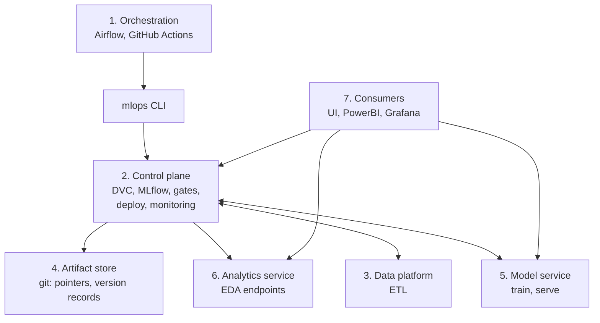
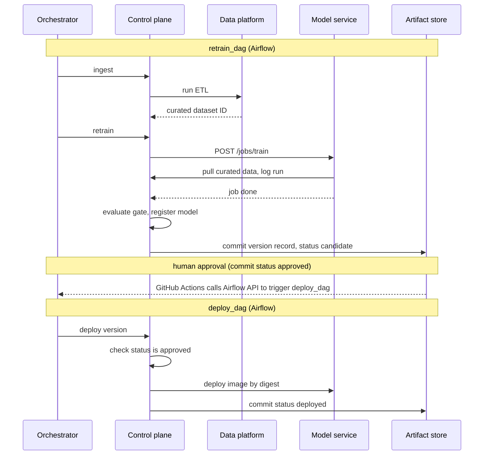
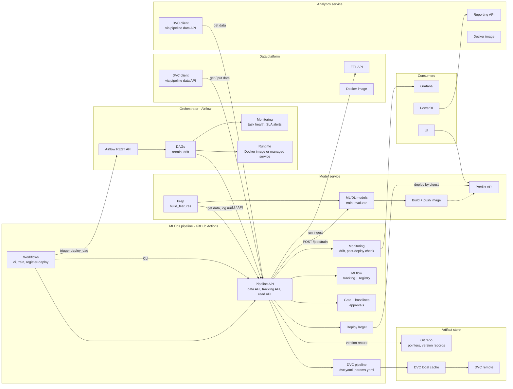
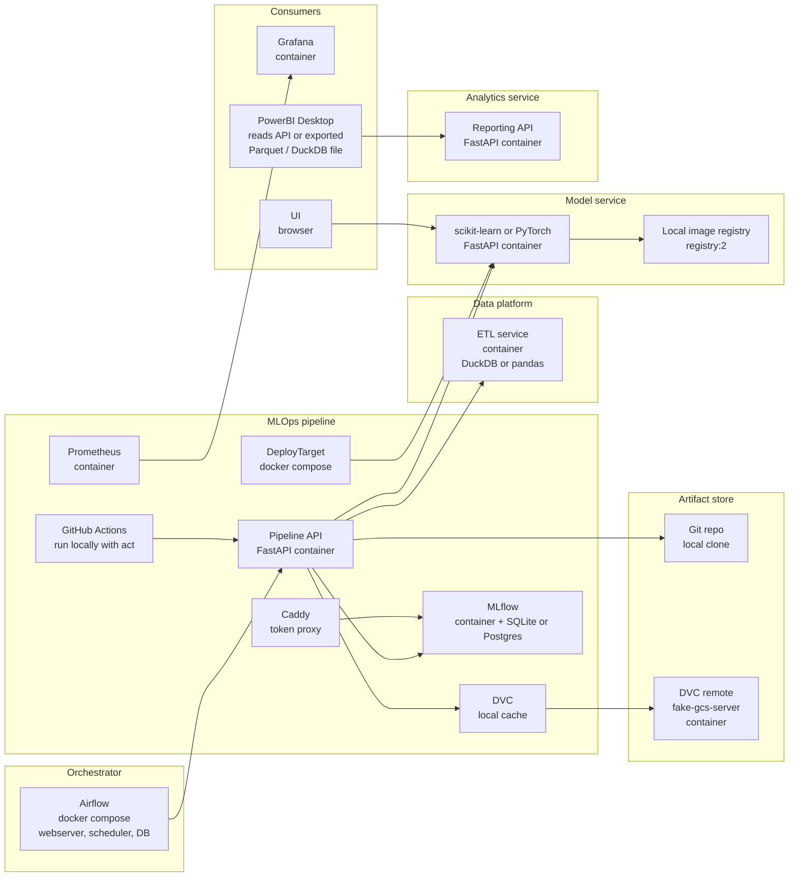
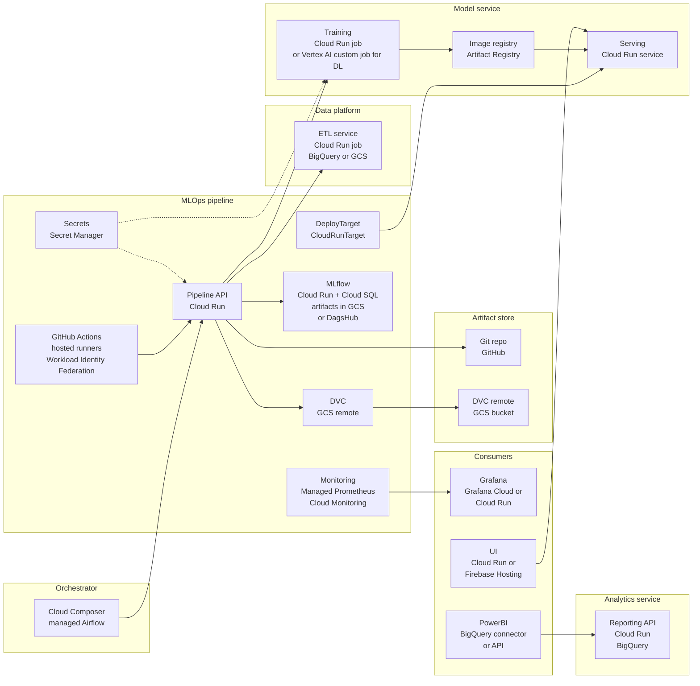

# Reusable Batch MLOps Framework Plan (v1)

**Trigger to start:** the drift pipeline is complete.

## Goal

One batch framework runs any model (regression, classification, clustering, later DL) through the same data, training, deploy, and orchestration flow. Model-specific and project-specific code lives in plugins and per-project services. Framework core is a shared library.

## Decisions

1. **Separate repos:** framework core, each layer, each project. ETL has its own repo and its own Docker image.
2. **One image per deployable service.** Model service, analytics service, and data platform each build their own image.
3. **One-to-one per model:** one control plane, one model service, one orchestrator instance, one artifact repo.
4. **One data platform and one analytics service per project.** Data platform is shared across models in a project only if they use the same source.
5. **No integration into the current plan.** Finish Phase 6, then split, then move remaining phases into their layers.
6. **Deploy targets are pluggable from day one.** Cloud Run and docker compose ship first. Kubernetes is a later adapter. The interface is defined now so K8s needs no framework change.
7. **Orchestrator split:**
   - **GitHub Actions:** CI on PRs, a separate infra pipeline (GCP up/down scripts, `workflow_dispatch` only, behind a GitHub `environments` approval), and the approval-commit trigger that calls the Airflow REST API.
   - **Airflow:** `retrain_dag` (ingest, train, evaluate, register, mark candidate), `deploy_dag` (deploy an approved version), `drift_dag`. DAGs call the control plane API only, never the model service, data platform, or ETL directly.
8. **Approval gate is a status on the version record,** not an Airflow Variable. Details in the "Approval and status" section.

## Layers

| # | Layer | Owns | Does not own |
|---|---|---|---|
| 1 | Orchestration | Airflow (`retrain_dag`, `deploy_dag`, `drift_dag`). GitHub Actions (CI, infra up/down pipeline, approval-commit trigger to Airflow). | Logic, deploy credentials. Calls the control plane API (directly or through the CLI), never services directly. |
| 2 | Control plane | DVC pipeline, MLflow (tracking, registry), gates, baselines, approvals, deploy, monitoring (drift, post-deploy check), data APIs, read APIs | Transforms, feature code |
| 3 | Data platform | ETL: extract, transform_raw, validate, load_curated. Emits versioned curated dataset ID. Own repo, own image. | DVC access (through control plane API), features, training |
| 4 | Artifact store | Git repo: `.dvc` pointers, `versions/<version>.json` | Runtime logic |
| 5 | Model service | Feature build and encoding, train, build and push image, `/predict` | ETL, reporting, DVC access (through control plane API) |
| 6 | Analytics service | Custom EDA and reporting endpoints for PowerBI. Read-only. | Feature build, training, ETL rerun |
| 7 | Consumers | UI, PowerBI, Grafana | Direct access to MLflow, DVC, git, or model internals |

## Architecture diagram

### Runtime view

The control plane is the hub. Every other service talks to it, never to DVC, MLflow, or git directly.



### Retrain flow



### Component view (technology-neutral)

Each box lists what the component contains. Arrows show who calls whom.



The DVC client boxes in the data platform and analytics service call the pipeline data API. They do not talk to the DVC remote directly. This keeps the rule "services never touch DVC directly".

### Local deployment view

Same structure, with local technology per node. Everything runs on one machine with Docker Compose.



### GCP deployment view

Same structure, with GCP or managed technology per node.



Rules shown by the diagrams:
- Orchestrators reach everything through the control plane API, directly or through the CLI.
- Services never touch DVC, MLflow, or git directly.
- Only the control plane holds deploy credentials. `deploy_dag` asks the control plane to deploy, and the control plane refuses unless the version is approved.
- Consumers read from the model service, analytics service, and control plane read APIs.
- Framework core (contract, data, gate, versioning, deploy, cli) is a library imported by the control plane, data platform, and model service. It is not a runtime box.

## Framework core (shared library, not a runtime layer)

- `framework/contract`: plugin interface definitions
- `framework/data`: ETL step implementations, used by data platform
- `framework/gate`: metric comparison, baseline logic
- `framework/versioning`: version record schema
- `framework/deploy`: `DeployTarget` interface and adapters (`CloudRunTarget`, `ComposeTarget`; `KubernetesTarget` later)
- `framework/cli`: `mlops` CLI, wraps control plane APIs

Interfaces live in framework core. Implementations live in each project's repo, except deploy adapters, which live in framework core.

## Plugin contract (implemented in project repo)

- **Identity:** `name`, `version`, `task_type` (`classification | regression | clustering`)
- **Data:** `load()`, `schema()` (pandera), `transform_raw(df)`
- **Features:** `target`, `features` (`target` is `None` for clustering), `build_features(df)` (single function used by train and serve)
- **Model:** `default_params`, `mlflow_flavor` (`sklearn | pytorch | pyfunc`), `build(params)`, `fit(model, X, y)`, `predict(model, X)`, optional `make_dataloaders()`
- **Metrics:** `metrics(y_true, y_pred)` for supervised, `metrics(X, labels)` for clustering, `gate_metric` (name, direction)
- **Serving:** `request_model` (explicit pydantic model)

Plugin loads by import path: `model_plugin: pkg.module:Plugin` in `params.yaml`.

## Deploy target seam

```
DeployTarget
  deploy(image_digest, env, config_ref) -> DeployResult
  status(deploy_id) -> DeployStatus
  rollback(deploy_id, previous_digest) -> DeployResult
```

- Control plane calls `DeployTarget`, never a cloud SDK directly.
- Config is passed as a secret reference, not a value.
- `KubernetesTarget` adds: Deployment, Service, Helm or Kustomize per model. Training as K8s Job or Argo. Decided when the first K8s target exists. Only the adapter and the train-job runner change.

## Data flow

1. `retrain_dag` calls the control plane `ingest` action (CLI: `mlops run ingest --model <name>`). Control plane calls the data platform, which runs ETL and emits a curated dataset ID.
2. Control plane registers the curated dataset ID through its data API and commits the pin to `params.yaml` in a pipeline run.
3. `retrain_dag` calls the control plane `retrain` action. Control plane runs DVC stages. Train stage calls model service `POST /jobs/train` and polls for completion.
4. Model service pulls the curated dataset through the control plane data API, runs `build_features`, trains, and logs to MLflow through the control plane tracking API.
5. Control plane runs the evaluate gate, registers the model, builds the image, and writes the version record with `status: candidate`. `retrain_dag` ends here. Dev and staging auto-set `approved`.
6. A human sets `status: approved` by committing to the artifact repo (or merging a PR). A GitHub Actions workflow on that commit calls the Airflow REST API to trigger `deploy_dag`.
7. `deploy_dag` calls the control plane deploy action. Control plane checks `status: approved`, deploys through the `DeployTarget`, and records `status: deployed`.

## Approval and status

Version record `status` values: `candidate`, `approved`, `deployed`, `rejected`.

- Transitions: `candidate -> approved -> deployed`, or `candidate -> rejected`. The control plane is the only writer of `candidate` and `deployed`. A human writes `approved` or `rejected` by commit.
- The artifact repo history is the audit trail: reviewer, timestamp, reason.
- Prod deploy requires `approved`. The control plane deploy API enforces this, so a manual `deploy_dag` trigger cannot bypass the gate.
- Dev and staging may auto-set `approved`.
- Until the approval workflow exists, you set the value by hand.

## Config

- `params.yaml` (control plane repo): model import path, curated dataset ID, experiment params, deploy target name.
- `profiles/*.env`: endpoints and secret references only. No model selection.
- Orchestrators pass `model=<name>` to the control plane. One DAG template per DAG type, schedule per model in config.

## Gate and baseline

- Baseline per model in control plane: `baselines/<model>/metrics_baseline.json`.
- Bootstrap: first run with no baseline seeds it and passes, with a logged warning. No auto-seed after that.
- Clustering gate uses an unsupervised metric (e.g., silhouette). Never compares to labels.

## Provenance

Version record holds: plugin name and version (or git SHA), curated dataset ID, MLflow run ID, registry version, image digest, DVC hashes, deploy target, and `status`. Required to reproduce a model.

## Rules

- Orchestrators call the control plane API, directly or through the CLI. They never call the model service, data platform, or ETL directly. No logic in DAGs or workflows.
- Approval gates and deploy credentials live in the control plane. `deploy_dag` requests a deploy, and the control plane refuses unless `status: approved`.
- The infra pipeline (GCP up/down) is `workflow_dispatch` only, behind a GitHub `environments` approval. It is never run automatically by tooling.
- Consumers and services never call MLflow, DVC, or git directly. Access goes through control plane APIs.
- Async jobs carry an idempotency key. Resubmitting the same key returns the existing job, never trains twice.
- Each service holds only its own credentials, from the secret store. No shared secrets across layers.
- Cloud or cluster SDK calls live only inside `framework/deploy` adapters.

## Extension notes

- **Deep learning:** same contract plus `make_dataloaders()`. CUDA base image. Checkpoints. GPU runner.
- **Kubernetes:** new `KubernetesTarget` adapter, no contract change. Decided later.
- **Different orchestrator:** only DAG files change, since orchestrators hold no logic.
- **Streaming:** separate framework.

## Phased rollout

- **P-A:** define contract and `DeployTarget` interface in framework core. Move Iris behind the contract. No behavior change. Existing tests and gate pass unchanged.
- **P-B:** split data platform into its own repo and image. ETL emits curated dataset ID. Control plane data API serves it.
- **P-C:** fake reference plugin under `tests/`, task type `clustering`. Uses synthetic data and a trivial model with no labels. CI runs the full pipeline with it. Proves reuse with no framework edits, and exercises the no-`y` path through the gate and metrics. If edits are needed, fix the contract. Add a second tiny fake plugin (regression) only if the first run exposes contract gaps.
- **P-D:** Airflow `retrain_dag`, `deploy_dag`, and `drift_dag`, parameterized by model. Includes the `status` field handling in the control plane and the GitHub Actions workflow that triggers `deploy_dag` on an approval commit.

**v1 scope:** P-A, P-B, P-C, P-D.
